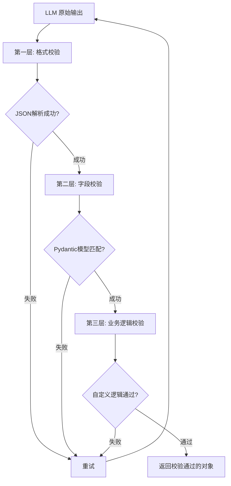
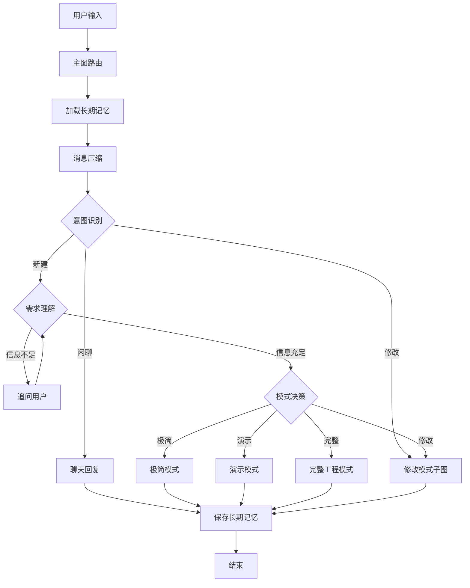
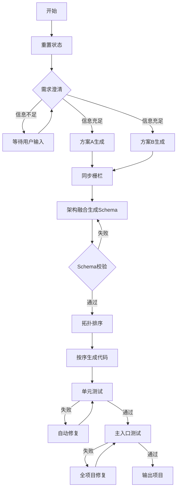
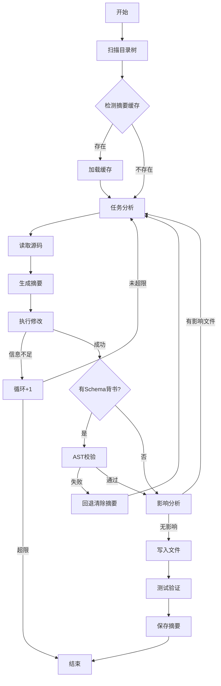
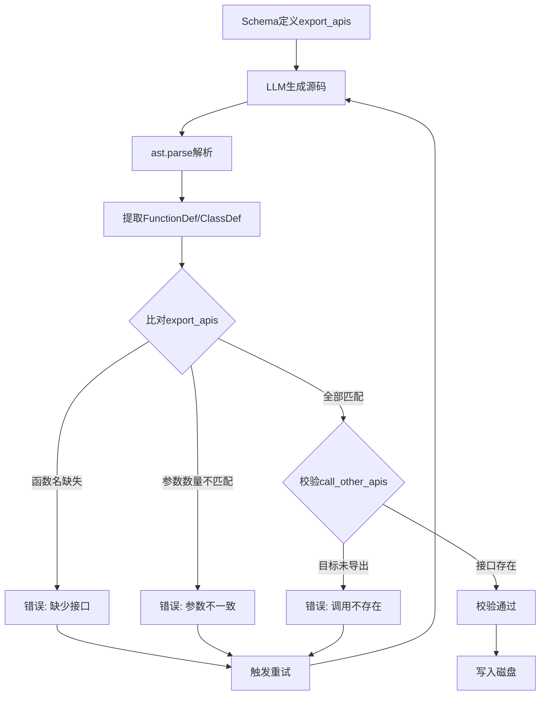
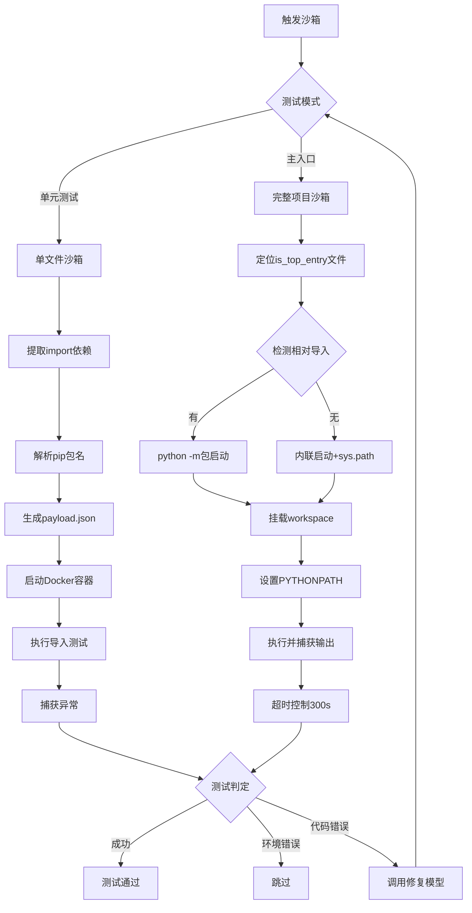
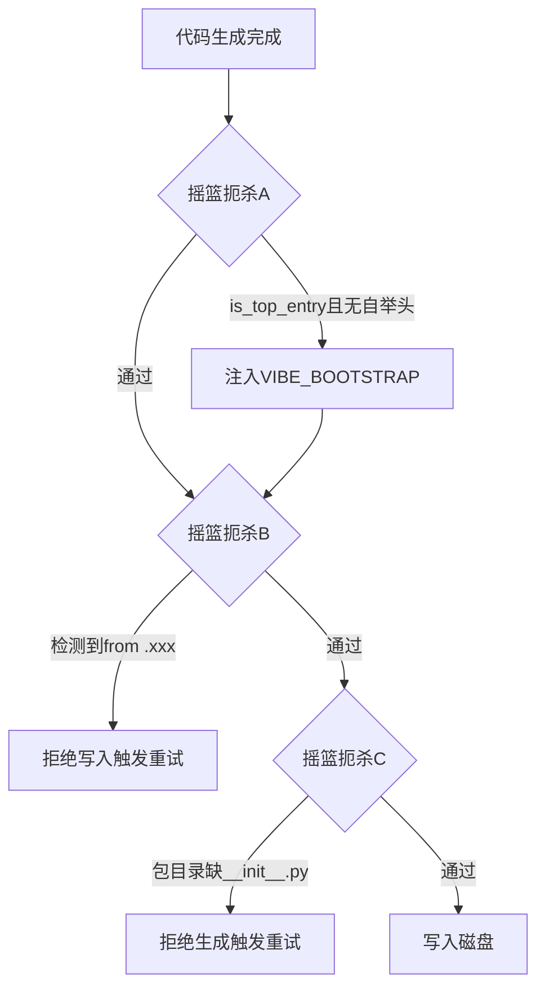

## 1. 项目概述

`VibeCoding` 是一个基于 **LangGraph** 构建的智能代码生成与修改引擎。它通过有状态图编排多智能体协作流程，能够根据自然语言需求自动生成或修改可运行的 Python 项目。

### 1.1 核心设计哲学

| 原则                  | 说明                                                      |
| :-------------------- | :-------------------------------------------------------- |
| **契约先行**          | 架构阶段定义 `export_apis`，代码生成阶段通过 AST 强制校验 |
| **Pydantic 三层校验** | 格式校验 → 业务逻辑校验 → 架构契约校验，层层把关          |
| **摇篮扼杀**          | 生成阶段即阻断包路径、相对导入、入口自举三类错误          |
| **全配置化**          | 新增 LLM 供应商只需 YAML 配置，无需修改 Python 代码       |
| **缓存优先**          | 代码摘要缓存（MD5 键），二次修改可节省 80%+ LLM 调用      |

### 1.2 四种工作模式

| 模式             | 适用场景             | 关键特性                           |
| :--------------- | :------------------- | :--------------------------------- |
| **极简模式**     | 单文件脚本、快速原型 | 无追问，秒级响应                   |
| **演示模式**     | 多文件项目原型       | 有追问，语法沙箱检查               |
| **完整工程模式** | 大型多模块项目       | 双方案 + Schema + AST + 沙箱测试   |
| **修改模式**     | 已有项目迭代修复     | 摘要缓存 + 影响分析 + 契约回归校验 |

---

## 2. Pydantic 三层校验体系

Pydantic 在系统中承担了 **三层校验** 职责，确保 LLM 输出在所有环节都是结构正确、语义完整的。

### 2.1 校验体系全景图



### 2.2 第一层：格式校验（JSON 解析）

**动作**：`clean_json_data()` 清洗 LLM 输出的 Markdown 包裹，提取纯净 JSON。

**清洗逻辑**：
1. 去除 ` ```json ` 和 ` ``` ` 标记
2. 使用正则 `r"(\{[\s\S]*\}|\[[\s\S]*\])"` 提取 JSON 主体
3. 如果提取失败，触发重试

```python
def clean_json_data(json_str: str) -> str:
    content = json_str.strip()
    if content.startswith("```json"):
        content = content.removeprefix("```json").removesuffix("```")
    elif content.startswith("```"):
        content = content.removeprefix("```").removesuffix("```")
    content = content.strip()
    match = re.search(r"(\{[\s\S]*\}|\[[\s\S]*\])", content)
    if match:
        content = match.group(0)
    return content.strip()
```

### 2.3 第二层：字段校验（Pydantic 模型）

系统定义了 11 个核心 Pydantic 模型，覆盖所有 LLM 输出节点。

| 模型名称              | 用途             | 关键字段                                                 |
| :-------------------- | :--------------- | :------------------------------------------------------- |
| `ClarifyOutput`       | 需求澄清输出     | `is_enough`, `final_requirement`, `questions`            |
| `SchemaOutput`        | 完整模式架构输出 | `project_name`, `directory_tree`, `generation_order`     |
| `FileItem`            | 单个文件定义     | `file_path`, `export_apis`, `call_other_apis`            |
| `ExportApi`           | 接口契约定义     | `name`, `type`, `params`, `return_desc`                  |
| `CallOtherApi`        | 调用关系定义     | `target_file`, `api_name`                                |
| `ImplementationGuide` | 实现指南         | `core_logic`, `key_functions`, `error_scenarios`         |
| `TestGuide`           | 测试指南         | `can_test`, `skip_reason`, `test_cases`                  |
| `ChangeCodeOutput`    | 修改模式输出     | `is_enough_info`, `changed_files`, `processed_file_list` |
| `SandboxJudgeOutput`  | 沙箱判定输出     | `success`, `is_environment_error`, `brief_reason`        |
| `MainFixOutput`       | 主测修复输出     | `is_environment_error`, `modified_files`                 |
| `SingleFileOutput`    | 单文件生成输出   | `code`, `summary`                                        |

### 2.4 第三层：业务逻辑校验（自定义校验函数）

Pydantic 校验通过后，系统会调用自定义业务逻辑校验函数，检查更深层次的语义正确性。

| 校验函数                      | 所属模型            | 校验内容                                   |
| :---------------------------- | :------------------ | :----------------------------------------- |
| `validate_schema_logic`       | `SchemaOutput`      | 循环依赖、接口闭环、入口唯一性             |
| `validate_change_code_logic`  | `ChangeCodeOutput`  | `is_enough_info` 与 `changed_files` 一致性 |
| `validate_file_summary_logic` | `FileSummaryOutput` | `rel_path` 非空                            |
| `validate_main_fix_logic`     | `MainFixOutput`     | 环境错误与修改文件一致性                   |
| `validate_package_structure`  | `SchemaOutput`      | 包目录是否有 `__init__.py`                 |

### 2.5 统一的校验调用函数 `invoke_with_validation`

所有 LLM 输出节点都通过此函数统一处理三层校验：

```python
def invoke_with_validation(
    model: ChatOpenAI,
    prompt: str,
    pydantic_model: Type[BaseModel],
    max_retries: int = 2,
    node_name: str = "unknown",
    logic_validator: Optional[Callable[[BaseModel], List[str]]] = None,
) -> BaseModel:
    """
    统一的 LLM 输出校验函数
    1. 调用 LLM
    2. JSON 格式清洗
    3. Pydantic 字段校验
    4. 自定义业务逻辑校验
    5. 失败时自动重试（带错误反馈）
    """
```

**重试时的错误反馈机制**：
- 累积错误历史（最多保留 3 条）
- 将错误信息追加到 Prompt 中，指导 LLM 修正

---

## 3. 系统架构全景图



### 图 3.1 主图路由节点说明

| 序号 | 节点名称     | Pydantic 校验   | 输入                     | 输出                         |
| :--- | :----------- | :-------------- | :----------------------- | :--------------------------- |
| 1    | 加载长期记忆 | 无              | user_id, conv_id         | 记忆文本                     |
| 2    | 消息压缩     | 无              | messages                 | 压缩后 messages              |
| 3    | 意图识别     | 无              | user_requirements        | is_chat/create/modify        |
| 4    | 聊天回复     | 无              | user_requirements + 历史 | AI 回复                      |
| 5    | 需求理解     | `ClarifyOutput` | user_requirements + 历史 | mode, is_complete, questions |
| 6    | 追问用户     | 无              | clarify_questions        | 用户补充回答                 |
| 7    | 模式决策     | 无              | current_mode             | 最终 mode                    |
| 8    | 保存长期记忆 | 无              | messages[-8:]            | 写入 SQLite                  |

---

## 4. 完整工程模式详解



### 4.1 各阶段 Pydantic 校验覆盖

| 阶段         | 使用的 Pydantic 模型 | 自定义校验函数                 |
| :----------- | :------------------- | :----------------------------- |
| 需求澄清     | `ClarifyOutput`      | 无                             |
| 架构方案 A   | 无（Markdown 输出）  | 无                             |
| 架构方案 B   | 无（Markdown 输出）  | 无                             |
| 架构融合     | `SchemaOutput`       | `validate_schema_logic`        |
| 代码生成     | `SingleFileOutput`   | `validate_code_against_schema` |
| 单元测试判定 | `SandboxJudgeOutput` | 无                             |
| 主测试判定   | `SandboxJudgeOutput` | 无                             |
| 主测修复     | `MainFixOutput`      | `validate_main_fix_logic`      |

### 4.2 SchemaOutput 完整模型定义

```python
class SchemaOutput(BaseModel):
    project_name: str
    project_desc: str = Field(default="")
    entry_file: str = Field(default="")
    dependencies: SchemaDependencies
    directory_tree: List[DirectoryItem]
    business_context: BusinessContext
    generation_order: List[GenerationItem]
    data_models: Dict[str, DataModel] = Field(default_factory=dict)
    error_registry: Dict[str, ErrorDefinition] = Field(default_factory=dict)
    layer_rules: LayerRules = Field(default_factory=LayerRules)

class FileItem(BaseModel):
    file_path: str
    file_purpose: str
    depend_on_files: List[str] = Field(default_factory=list)
    is_test_file: bool = False
    can_unit_test: bool = False
    is_top_entry: bool = False
    export_apis: List[ExportApi] = Field(default_factory=list)
    call_other_apis: List[CallOtherApi] = Field(default_factory=list)
    implementation_guide: ImplementationGuide
    test_guide: TestGuide
```

### 4.3 Schema 业务逻辑校验详情

`validate_schema_logic` 检查以下内容：

| 校验项               | 说明                           | 失败示例                                  |
| :------------------- | :----------------------------- | :---------------------------------------- |
| 循环依赖检测         | 依赖图中是否有环               | `a.py` → `b.py` → `a.py`                  |
| 接口闭环校验         | `call_other_apis` 目标是否存在 | 调用 `user.find_user` 但 `user.py` 未导出 |
| 入口唯一性           | `is_top_entry` 是否只有 1 个   | 多个文件标记为 true                       |
| 文件存在性           | 所有依赖文件都在目录树中       | `depend_on_files` 引用了不存在的文件      |
| `__init__.py` 完整性 | 包目录是否有 `__init__.py`     | `src/models/` 无 `__init__.py`            |

---

## 5. 修改模式详解



### 5.1 修改模式 Pydantic 模型

| 模型                  | 用途                 | 关键字段                                                 |
| :-------------------- | :------------------- | :------------------------------------------------------- |
| `DetectSummaryOutput` | 检测摘要文件是否存在 | `exist_summary_file`, `summary_file_rel_path`            |
| `FileSummaryOutput`   | 文件摘要             | `rel_path`, `file_desc`, `export_apis`, `depend_on`      |
| `ChangeCodeOutput`    | 修改执行输出         | `is_enough_info`, `changed_files`, `processed_file_list` |
| `SandboxJudgeOutput`  | 沙箱判定             | `success`, `is_environment_error`, `brief_reason`        |
| `MainFixOutput`       | 主测修复             | `is_environment_error`, `modified_files`                 |

### 5.2 修改模式校验函数

| 校验函数                       | 校验内容                                   | 失败处理        |
| :----------------------------- | :----------------------------------------- | :-------------- |
| `validate_change_code_logic`   | `is_enough_info` 与 `changed_files` 一致性 | 触发重试        |
| `validate_file_summary_logic`  | `rel_path` 非空                            | 跳过该文件      |
| `validate_main_fix_logic`      | 环境错误与修改文件一致性                   | 标记为环境错误  |
| `validate_code_against_schema` | 修改后代码的 AST 契约                      | 回退 + 清除摘要 |

---

## 6. AST 契约校验机制



### 6.1 校验函数签名

```python
def validate_code_against_schema(
    source_code: str,
    expected_apis: List[Dict]
) -> List[str]:
    """
    返回错误列表，空列表表示通过

    expected_apis 格式:
    [
        {
            "name": "create_user",
            "type": "函数",
            "params": [
                {"param_name": "username", "param_type": "str", "desc": "用户名"}
            ],
            "return_desc": "dict 包含 user_id",
            "exception": "邮箱已存在时抛出 ValueError"
        }
    ]
    """
```

### 6.2 AST 提取逻辑

| 节点类型      | 提取内容              | 过滤规则                  |
| :------------ | :-------------------- | :------------------------ |
| `FunctionDef` | 函数名、参数列表      | 排除以 `_` 开头的私有函数 |
| `ClassDef`    | 类名、`__init__` 参数 | 提取 `__init__` 方法参数  |

---

## 7. Docker 沙箱执行机制



### 7.1 沙箱配置参数

| 参数           | 配置键                   | 默认值           |
| :------------- | :----------------------- | :--------------- |
| Docker 镜像    | `sandbox_image`          | `sandbox-web:v1` |
| 单元测试超时   | `single_sandbox_timeout` | 240s             |
| 主入口测试超时 | `main_sandbox_timeout`   | 300s             |
| 单元测试重试   | `unit_test_max_retry`    | 3                |
| 主测试重试     | `main_test_max_retry`    | 3                |

### 7.2 沙箱判定 Pydantic 模型

```python
class SandboxJudgeOutput(BaseModel):
    success: bool
    is_environment_error: bool = False
    brief_reason: str = Field(default="")
    error_detail: str = Field(default="")
```

---

## 8. 摇篮扼杀机制 A/B/C



### 8.1 摇篮扼杀 A：入口自举头

**触发条件**：`file_item.is_top_entry == True`

**注入的代码块**：
```python
# >>> VIBE_BOOTSTRAP >>>
import os as _V_os, sys as _V_sys
_V_PROJECT_ROOT = _V_os.path.abspath(_V_os.path.join(_V_os.path.dirname(__file__), "..", ".."))
if _V_PROJECT_ROOT not in _V_sys.path:
    _V_sys.path.insert(0, _V_PROJECT_ROOT)
_V_SRC_ROOT = _V_os.path.join(_V_PROJECT_ROOT, "src")
if _V_os.path.isdir(_V_SRC_ROOT) and _V_SRC_ROOT not in _V_sys.path:
    _V_sys.path.insert(0, _V_SRC_ROOT)
del _V_os, _V_sys, _V_PROJECT_ROOT, _V_SRC_ROOT
# <<< VIBE_BOOTSTRAP <<<
```

### 8.2 摇篮扼杀 B：绝对导入禁令

**检测方式**：
1. AST 精确检测：遍历 `ImportFrom` 节点，检查 `level >= 1`
2. Regex 兜底检测：`r"(?m)^\s*from\s+\.{1,}[\w\.]*\s+import\b"`

**失败示例**：
- `from .models import User` → ❌ 拒绝
- `from ..utils import helper` → ❌ 拒绝

### 8.3 摇篮扼杀 C：包结构完整性

**检测方式**：
1. 统计目录树中所有 `.py` 文件
2. 识别包前缀（出现 >= 2 次的目录）
3. 检查包目录下是否有 `__init__.py`

**失败示例**：
- `src/models/` 下有两个 `.py` 文件但没有 `__init__.py` → ❌ 拒绝

---

## 9. 数据库设计

| 数据库          | 路径         | 用途                  | 主要表                               |
| :-------------- | :----------- | :-------------------- | :----------------------------------- |
| `agent_data.db` | 项目根目录   | Checkpoint + 长期记忆 | `checkpoints`, `conversation_memory` |
| `code_cache.db` | 项目根目录   | 代码摘要缓存          | `code_cache`                         |
| `business.db`   | `app_route/` | 对话元数据            | `conversations`, `messages`          |

### 9.1 conversation_memory 表结构

| 字段        | 类型      | 说明                                         |
| :---------- | :-------- | :------------------------------------------- |
| id          | INTEGER   | 自增主键                                     |
| user_id     | TEXT      | 用户标识                                     |
| conv_id     | TEXT      | 对话标识                                     |
| memory_type | TEXT      | `preference` / `history_project` / `general` |
| content     | TEXT      | 记忆内容                                     |
| meta_json   | TEXT      | 扩展元数据                                   |
| created_at  | TIMESTAMP | 创建时间                                     |

### 9.2 code_cache 表结构

| 字段         | 类型      | 说明                               |
| :----------- | :-------- | :--------------------------------- |
| cache_key    | TEXT      | PRIMARY KEY，MD5(file_path + code) |
| file_path    | TEXT      | 文件路径                           |
| summary_json | TEXT      | 摘要 JSON                          |
| created_at   | TIMESTAMP | 创建时间                           |

---

## 10. 配置说明

### 10.1 模型配置清单

| 配置键                    | 默认模型          | Pydantic 校验模型     |
| :------------------------ | :---------------- | :-------------------- |
| `ask_model`               | qwen-plus         | `ClarifyOutput`       |
| `front_plan_model_one`    | qwen-plus         | 无（Markdown 输出）   |
| `front_plan_model_two`    | deepseek-v4-flash | 无（Markdown 输出）   |
| `back_plan_model`         | deepseek-v4-pro   | `SchemaOutput`        |
| `code_generate_model`     | deepseek-v4-flash | `SingleFileOutput`    |
| `test_fix_model`          | deepseek-v4-pro   | `MainFixOutput`       |
| `test_judge_model`        | qwen-plus         | `SandboxJudgeOutput`  |
| `simple_generate_model`   | qwen-turbo        | 无                    |
| `demo_generate_model`     | qwen-plus         | 无                    |
| `analyze_change_model`    | deepseek-v4-flash | `DetectSummaryOutput` |
| `code_change_model`       | qwen3.7-plus      | `ChangeCodeOutput`    |
| `change_test_fix_model`   | qwen3.7-plus      | `MainFixOutput`       |
| `change_test_judge_model` | qwen-plus         | `SandboxJudgeOutput`  |

### 10.2 重试配置

| 配置键                 | 默认值 | 说明                 |
| :--------------------- | :----- | :------------------- |
| `default`              | 2      | 默认重试次数         |
| `critical_retry`       | 3      | Schema 生成重试次数  |
| `normal_retry`         | 2      | 普通生成重试次数     |
| `judge_retry`          | 1      | 判定节点重试次数     |
| `detect_summary_retry` | 1      | 摘要检测重试次数     |
| `file_summary_retry`   | 2      | 文件摘要生成重试次数 |
| `change_code_retry`    | 2      | 修改执行重试次数     |
| `sandbox_judge`        | 1      | 沙箱判定重试次数     |

---

## 11. 快速开始

### 11.1 环境准备

```bash
# Python 版本
python --version  # 需要 3.10+

# 安装依赖
pip install langgraph langchain-core langchain-openai docker pyyaml python-dotenv pydantic flask
```

### 11.2 配置文件

**`.env` 文件**：
```env
ALI_API_KEY=sk-xxx
DEEPSEEK_API_KEY=sk-yyy
```

**`my_config.yaml` 关键路径**：
```yaml
create_project_path: "/path/to/new_project"
change_project_path: "/path/to/existing_project"
```

### 11.3 启动 Web 服务

```bash
cd my_vibecoding/app_route
python app.py
# 访问 http://127.0.0.1:5000
```

---

## 12. 故障排查

### 12.1 常见错误

| 错误                        | 原因                                       | 解决方案                           |
| :-------------------------- | :----------------------------------------- | :--------------------------------- |
| Pydantic 校验失败           | LLM 输出字段不匹配                         | 检查 Prompt 或增加重试次数         |
| `SchemaOutput` 校验失败     | `generation_order` 有循环依赖              | 检查 Schema 中的 `depend_on_files` |
| `ChangeCodeOutput` 校验失败 | `is_enough_info` 与 `changed_files` 不一致 | 检查修改分析逻辑                   |
| 沙箱判定失败                | `SandboxJudgeOutput` 字段缺失              | 检查 `test_judge_model` 输出       |

### 12.2 调试技巧

```python
# 开启详细日志
CURRENT_LOG_LEVEL = LOG_LEVEL_DEBUG

# 查看缓存命中
SELECT * FROM code_cache WHERE file_path LIKE '%book_service%';

# 查看 Pydantic 校验错误
# 在 invoke_with_validation 中打印 error_history
```

---

> **版本**: v3.0.0 | **最后更新**: 2026-09-02 | **兼容 Mermaid**: 8.14+

## 联系方式

- 作者：李龙
- 邮箱：3490765269@qq.com
